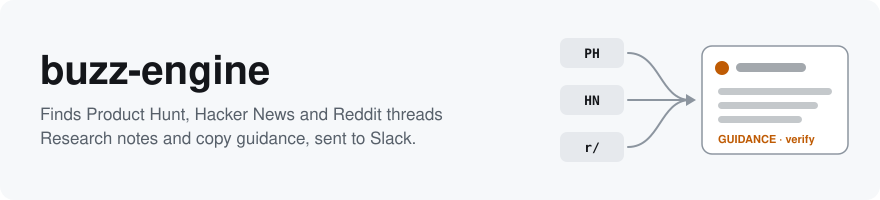
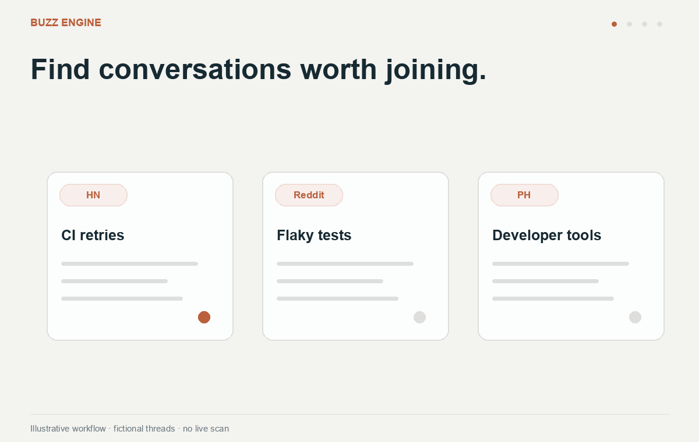

<picture>
  <source media="(prefers-color-scheme: dark)" srcset=".github/assets/banner-dark.svg">
  
</picture>


[](LICENSE)

Version 0.1.0, pre-release. Config keys
and command flags may still change before 1.0, and each change is listed in the
[changelog](docs/CHANGELOG.md).

With the Actions schedule configured, buzz-engine sends a weekday briefing to your
team's Slack channel.
It's a handful of Product Hunt, Hacker News and Reddit threads where your space is being
discussed, with research notes or copy guidance for the most relevant threads.

Buzz recommends copy as guidance. Follow platform and community rules; write and post
your own content. HN output is research only: HN prohibits generated and AI-edited
comments, so write any HN contribution independently.



Relevant threads → research notes and copy guidance → Slack digests + PDFs. [Demo notes](.github/assets/demo/README.md).

## Contents

[What it does](#what-it-does) · [Quick start](#quick-start) ·
[Choosing a command](#choosing-a-command) · [Usage](#usage) · [Reference](#reference) ·
[Before you rely on it](#before-you-rely-on-it) · [Project](#project)

## What it does

- `/buzz-daily --no-post` scans the configured platforms and writes local PDFs. The
  Actions workflow delivers them to Slack in a separate job, then opens a seen-log PR
  for delivered lanes. Review and merge that PR to retain deduplication between runs.
- `/buzz --mode ph|hn|reddit` does the same for one platform, right now. It scores each
  thread against your product's space and provides research notes or copy guidance.
- `/buzz --mode brands` counts how often your brand and your competitors are mentioned
  on HN and Reddit.
- `/buzz-init` writes your `buzz/config.yaml` and checks each dependency and each token
  you have set.

What it does not do:

- It never posts, comments, upvotes or follows on Product Hunt, HN or Reddit. A person
  posts every comment by hand.
- It avoids promotional product mentions and links; relevant affiliations must still be disclosed.
- It reads thread replies as source context, but does not monitor replies to your own
  contributions or read Slack messages and reactions.
- It doesn't track whether a posted comment did well. You log that yourself in
  `buzz/learnings/`.

## Quick start

Claude or Codex still needs its own model authentication. HN discovery needs no platform
token. Reddit discovery additionally requires a configured `reddit.user_agent`.

For the Claude plugin, you need Claude Code 2.1.278 or later, Python 3.9+ with the
[pinned requirements](requirements.txt), and Chrome or Chromium for the PDF. The HN
preview below needs no platform tokens and posts nothing.

In a terminal, make a scratch repo and install the plugin into it. The commands below use the maintained repository.

```bash
mkdir buzz-try && cd buzz-try && git init
claude plugin marketplace add tetriz-ai/buzz-engine --scope project
claude plugin install buzz-engine@buzz-engine --scope project
```

Then run `claude` in that folder and type these two commands. `/buzz-init` asks about your
product. Fill in product names, domains, and relevance pillars; tokens, account
handles, and Slack setup can wait for a live run.

```
/buzz-init
/buzz --mode hn --dry-run --pdf
```

The digest lands in `buzz/working/`, and the summary looks like this:

```
hn 29-09 - 12 scanned · 3 cards · 5 filtered signals · 4 skipped.
PDF: buzz/working/hn-digest-29-09-2026.pdf
Seen-log untouched (dry run).
```

A card contains research notes or copy guidance for one thread. A filtered signal is a
relevant thread to read and evaluate independently; it is not a request to vote.

To post to Slack and run it every weekday, follow [SETUP.md](SETUP.md).

## Use with Codex

Buzz also provides a native Codex skill. It reads the same commands, rubrics, humanizer,
voice and scripts as the Claude plugin; there is no separate Codex pipeline.

Clone this repository to a persistent location, then link the skill into your project:

```bash
git clone https://github.com/tetriz-ai/buzz-engine /path/to/buzz-engine
python3 /path/to/buzz-engine/scripts/install-codex.py --into /path/to/your/project --dry-run
python3 /path/to/buzz-engine/scripts/install-codex.py --into /path/to/your/project
```

In Codex, use `$buzz-engine init`, then `$buzz-engine hn --dry-run --pdf`.
Other actions are `ph`, `reddit`, `brands` and `daily`. The link under
`.agents/skills/buzz-engine` points to the original checkout. Keep that checkout available;
rerun the installer on each teammate's machine. If discovery does not refresh, restart Codex.

Python 3.9+, `pyyaml` and Chrome/Chromium requirements are unchanged. PH and Slack still
need their configured tokens for live runs. Codex needs subagent tools for the phases that
delegate drafting to the humanizer. Missing tools leave those drafts incomplete.

The isolated GitHub Actions scheduler currently uses Claude. Codex can
run the same daily procedure in a Codex session; scheduling a Codex runner is separate.
Offline installation checks cover this adapter; verify live host and platform access in
your environment. Scanning and drafting default to a dry run until live delivery is authorized.

## Choosing a command

| You want to | Use | Example |
|---|---|---|
| Set up a new repo | [`/buzz-init`](#buzz-init) | `/buzz-init` |
| Try one platform now | [`/buzz`](#buzz) | `/buzz --mode hn --dry-run --pdf` |
| Count brand mentions | [`/buzz --mode brands`](#buzz---mode-brands) | `/buzz --mode brands` |
| Get a digest every weekday | [`/buzz-daily`](#buzz-daily) through Actions | `Run /buzz-daily --no-post` |

Every command reads the same `buzz/config.yaml`, and none of them posts anywhere except
Slack.

## Usage

### /buzz-init

When: once per repo, before anything else. With no flags it asks each question in turn.

```
/buzz-init --product Acme --domain acme.dev --channel C0123456789
```

Remember:

- **Scheduling:** use the isolated Actions workflow. Delivery and GitHub state writes
  run in separate jobs outside the source-reading model.
- **Existing config:** it never overwrites `buzz/config.yaml` unless you add `--force`.

### /buzz

When: to see one platform's digest now.

```
/buzz --mode ph --dry-run --pdf
```

Remember:

- **Dry run:** `--dry-run` posts nothing and leaves the seen-log unchanged, so it's safe to repeat.
  Without it, the threads you see won't come back tomorrow.
- **Tokens:** the PH lane needs `PH_API_TOKEN`. HN and Reddit need no token.

### /buzz --mode brands

When: you want to see who gets talked about in your space.

```
/buzz --mode brands
```

Remember:

- **Aliases:** list each brand's spellings under `brand_monitor.brands`. Keep them
  specific, because a short name like "dx" matches unrelated posts.
- **No Slack post:** the report is written to `buzz/working/`.

### /buzz-daily

When: from the isolated Actions workflow, once each weekday.

```
Run /buzz-daily --no-post
```

Remember:

- **Order:** it runs `schedule.lanes` in order, Product Hunt first, because makers watch
  their launch page most in the first hour.
- **Weekends:** it skips Saturday and Sunday, and on Monday it looks back 72 hours to
  cover them. To run every day, set `schedule.weekdays_only: false` and change the
  Actions cron to `5 8 * * *`.

The full command text is in [commands/](commands/). The supported Actions schedule
and interactive setup are described in [SETUP.md](SETUP.md).

## Reference

### Flags for /buzz

| Flag | What it does |
|---|---|
| `--mode ph\|hn\|reddit\|brands` | Picks the platform, or the mention report |
| `--pdf` | Renders a PDF briefing; Slack upload is suppressed by `--dry-run` or `--no-post` |
| `--dry-run` | Posts nothing, leaves the seen-log unchanged, and writes the digest to `buzz/working/` |
| `--no-post` | Writes local guidance/PDFs and updates the seen-log without Slack delivery |
| `--upvote-only` | Skips drafting and sends only filtered reading signals |
| `--lookback-hours N` | Overrides the scan window with N hours |
| `--no-commit` | Compatibility flag; source-reading commands never perform Git writes |

### Main config keys

| Key | What it sets |
|---|---|
| `product.never_mention` | Names that must never appear in a draft |
| `product.relevance_pillars` | What counts as your space. Every thread is scored 0 to 10 against it |
| `slack.channel_id` | Where the digest goes |
| `schedule.lanes` | Which platforms `/buzz-daily` runs, in order |
| `state.commit` | Use `none`; the Actions state job saves delivered IDs outside the model |
| `subreddits`, `keywords`, `ph.topics` | Where it looks and what it looks for |

Every key is explained in [templates/buzz.config.yaml](templates/buzz.config.yaml). The
reason behind each default is in [docs/config-notes.md](docs/config-notes.md).

### Terms

| Term | Meaning |
|---|---|
| Lane | One platform: `ph`, `hn` or `reddit` |
| Seen-log | `buzz/state/seen.json`, the thread IDs retained between scans |
| Card | One thread with research notes or copy guidance |
| Filtered signal | A relevant thread to read and evaluate independently |
| Scheduled run | The isolated Actions workflow with separate delivery and state jobs |

## Before you rely on it

HN cards are research only; never copy, edit, or post generated HN text. For other
platforms, use recommended copy as guidance and follow community rules. Never invent
experience, hide an affiliation, coordinate votes, or expect reciprocal launch support.
Product Hunt business use needs permission under its [API terms](https://api.producthunt.com/v2/docs).
Reddit requires your own `reddit.user_agent`; a blocked request stops rather than
impersonating a browser. Availability of RSS does not establish permission for every use.

Scraped material can contain prompt injection. Buzz treats it as data, but text rules
and tool restrictions cannot eliminate that risk. Review scheduled permissions and use
the workflow's separate delivery and state jobs so the model has no Slack or GitHub
write token.

These limits come from the platforms or from the design, and they matter before you rely
on the digest for anything important.

### What the digest can miss

**Misses threads (you never see them):**

- Reddit limits requests per IP address, so some subreddits drop out on busy days. The
  digest says when that happens.
- The PH lane scans the day's board at run time. Launches posted later that day are
  never seen.
- HN research cards exclude threads more than 24 hours old by default. Change this
  with `hn.comment_candidates.max_age_hours`.

**Shows too much (harmless):**

- PH keywords match anywhere in a launch's text, so "agent" also catches "travel agent".
  The judging step drops these, at the cost of a slot.

### Where guidance can be wrong

**Can mislead the person posting:**

- A card marked "excerpt only" wasn't checked against the full thread. It may repeat a
  point someone already made.
- Guidance about a linked project may be based only on its README. It can miss
  implementation details or undocumented behavior.

**Costs time only:**

- Copy guidance sometimes repeats an opening style across cards.

### Platform limits

**Can mislead the person posting:**

- Product Hunt API identity fields may be missing or redacted. Buzz does not fetch maker
  profiles or websites; verify any self-declared handle before deciding to contact someone.

**Costs time only:**

- The Slack bot can't read replies or reactions. Approvals happen between people in the
  thread.

More detail is in [docs/platform-notes.md](docs/platform-notes.md).

## Project

### Versioning and compatibility

Versions follow semver. Before 1.0, a renamed config key or a removed flag counts as
breaking and is listed in the changelog. The floor is Claude Code 2.1.278 and Python 3.9.

### Tests

The suite covers path handling, the config template, the PDF renderer, how the Slack
poster handles errors, the script that copies the plugin into a repo, and command
frontmatter, plus scanner identity, source-reading command boundaries, and isolated
delivery/state handling. The tests need no network.

```bash
python3 -m unittest discover -s tests -v
```

### Contributing, security and license

- **Contributing.** See [CONTRIBUTING.md](CONTRIBUTING.md). Every change needs a test.
- **Security.** Report a vulnerability privately, as described in [SECURITY.md](SECURITY.md),
  not in a public issue.
- **License.** [MIT License](LICENSE).

Copyright 2026 Workloom Solutions Private Limited.

Contributors are listed in [CONTRIBUTORS.md](CONTRIBUTORS.md).
